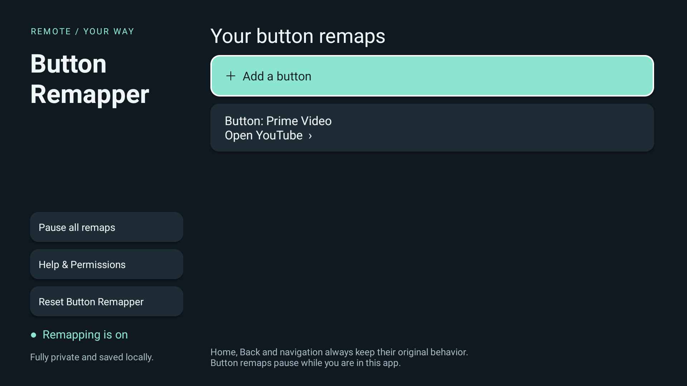
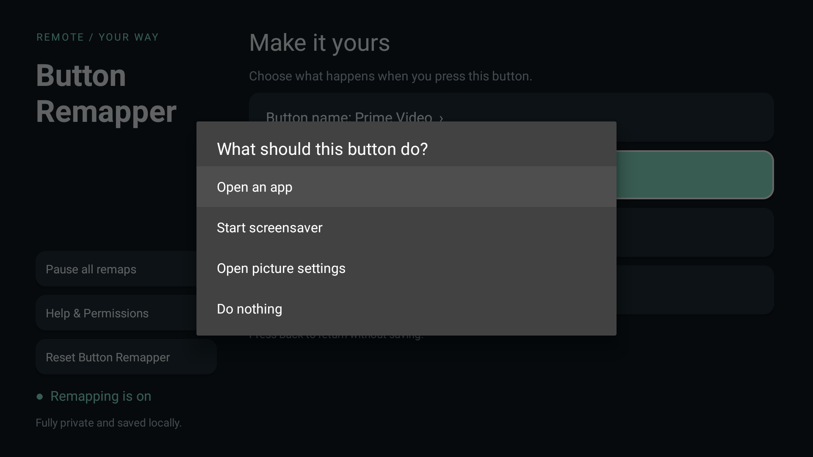
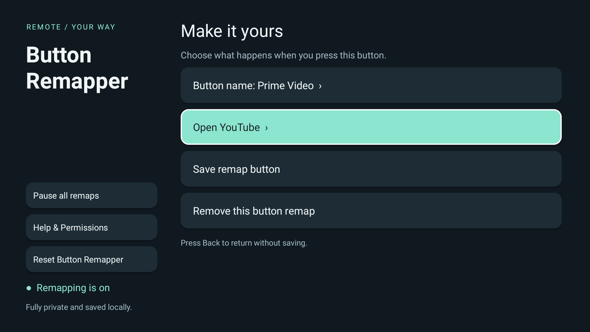

# Button Remapper

Give your Android TV remote buttons a new job. Open an installed app, start the screensaver on a compatible TV, open picture settings, or make a button do nothing.

**Fully private and saved locally.** No account, ads, analytics, or network access.

This is a vibe-coded app.



## Set up your first remap

1. Open **Button Remapper** and select **Agree & open settings** after reading the permission prompt.
2. In your TV’s Accessibility settings, find **Button Remapper** under **Services** or **Downloaded apps** and enable it. The exact menu varies by TV.
3. Return to the app, choose **Add a button**, and press the remote button you want to change.
4. Choose an action, then select **Save remap button**. You can also give the button a name you recognize.
5. Press **Home** and try it. Remaps pause while Button Remapper is open so you can navigate and edit.

| Choose an action | Edit your remap |
| --- | --- |
|  |  |

Select a saved remap to change or remove it. **Pause all remaps** keeps your choices for later. **Reset Button Remapper** deletes the app’s saved settings and disables its accessibility service; your TV settings and installed apps stay as they are. Press **Back** to close a dialog or leave an edit without saving.

## Compatibility and privacy

Requires **Android TV or Google TV running Android 8.0 or later**.

- Some TVs reserve buttons that apps cannot remap. Home, Back, navigation, power, and voice-assistant buttons always keep their original behavior.
- Picture settings and screensaver actions appear only when supported. Screensaver launch is available on compatible Android 8–12 TVs, not Android 13 or later.
- Remaps are stored locally and designed to survive app and normal TV restarts. Uninstalling or clearing app data deletes them. After a force-stop, you may need to reopen the app or re-enable its accessibility service.
- Testing has covered one physical TV. Other TVs and a full TV-reboot check remain unverified.

Accessibility permission lets the app detect remote button presses while other apps are open. It does not read your screen, record typing, or keep a button-press history. No data leaves the app. You can read the offline privacy policy under **Help & Permissions → Privacy policy**.

If a button does not work, try another button and check whether another button-remapping accessibility service is enabled.

## Build and install

You need **Docker** and **ADB**, with your TV already connected through ADB. Docker must support Linux amd64 containers, including emulation on Apple Silicon. Java 17 and the Android SDK run inside Docker; nothing else needs to be installed on your computer.

From the project directory:

```sh
./scripts/docker-build.sh
adb devices -l
adb install -r build/tv-button-remapper.apk
adb shell am start -n dev.antonio.tvremap/.MainActivity
```

The first build downloads the tools. Later app builds run offline. If more than one device is connected, use `adb -s DEVICE_SERIAL` for each ADB command.

This produces a development APK. Keep `.local/debug.keystore` to install future development updates over it, and keep that key out of version control. Store releases need a separate upload key.

The app uses native Java and Android APIs, with no third-party app or test libraries. For architecture, tests, and toolchain details, see the [development notes](docs/development.md).

## License

[MIT](LICENSE). You may use, modify, and redistribute the project, including commercially, while retaining the license and copyright notice.
