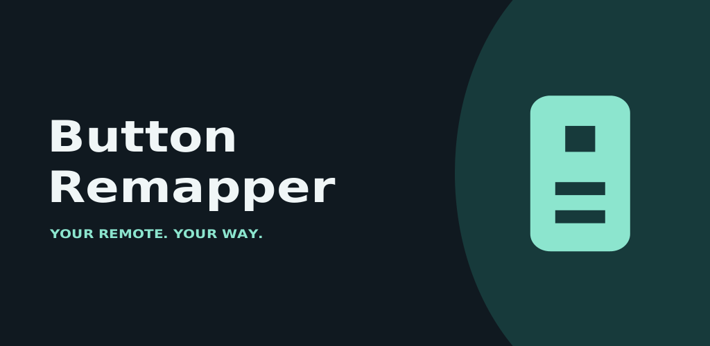

# Google Play submission materials

App name: **Button Remapper**. Default listing: English (United States).



## Upload map

| Play Console field | File | Format |
| --- | --- | --- |
| App name | `listing/en-US/title.txt` | Under 30 characters |
| Short description | `listing/en-US/short-description.txt` | Under 80 characters |
| Full description | `listing/en-US/full-description.txt` | Under 4,000 characters |
| Release notes | `listing/en-US/release-notes.txt` | English text |
| App icon | `graphics/icon-512.png` | 512 × 512, 32-bit PNG |
| Feature graphic | `graphics/feature-1024x500.png` | 1024 × 500, 24-bit PNG |
| Android TV banner | `graphics/tv-banner-1280x720.png` | 1280 × 720, 24-bit PNG |
| Android TV screenshots | `screenshots/en-US/*.png` | Actual TV captures, 1920 × 1080, 24-bit PNG |

The separate **in-app TV launcher banner** is `app/res/drawable-xhdpi/banner.png`, 320 × 180 pixels. It contains the app name. Do not upload this smaller image in the store banner field.

The graphics are original artwork based on this project's vector remote icon. No stock images, external illustration libraries, or third-party logos are used in the promotional graphics. Screenshots show the actual app, not mockups. Other app/button names may appear as functional examples; they do not imply affiliation.

## Rebuild artwork

```sh
./scripts/docker-build.sh
docker run --rm --platform linux/amd64 --network none \
  -v "$PWD:/workspace" tv-button-remapper-build bash scripts/artwork.sh
```

Source: `scripts/artwork/Artwork.java`, using only the JDK's Java2D and the Docker image's DejaVu font. Commit the generated PNGs so normal app builds do not need to regenerate them. The artwork script also accepts input/output paths to export raw screenshots as opaque RGB PNGs, without changing their content:

```sh
adb exec-out screencap -p > build/screenshot.png
docker run --rm --platform linux/amd64 --network none \
  -v "$PWD:/workspace" tv-button-remapper-build \
  bash scripts/artwork.sh build/screenshot.png store/screenshots/en-US/01-home.png
```

Retake screenshots whenever the visible app changes. Capture stable screens after transitions; keep notifications and personal data out. Use TV screenshot fields, not phone fields. A promotional store video is optional; the Accessibility API review video is a separate remaining task.

## Privacy policy

The [website privacy policy](../docs/privacy.html) needs the publisher and contact details filled in before hosting.

Asset requirements: https://support.google.com/googleplay/android-developer/answer/9866151
